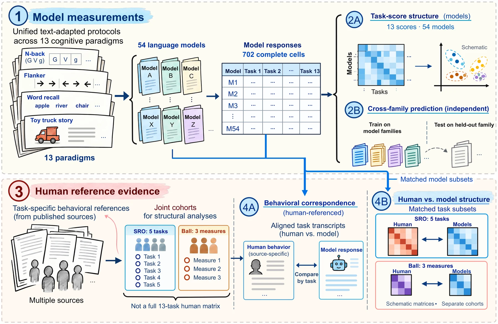

<div align="center">

<div id="user-content-toc">
  <ul align="center" type="none">
    <summary>
      <h1>CogBattery: Human-Referenced Evaluation of Cognitive Task Behavior and Structure in Language Models</h1>
    </summary>
  </ul>
</div>

<a href="https://www.python.org/"></a> &emsp;
<a href="#overview"></a> &emsp;
<a href="https://dengzhe-hou.github.io/CogBattery/#results"></a> &emsp;
<a href="LICENSE"></a>



<div id="toc">
  <ul align="center" type="none">
    <summary>
      <h2><a href="https://arxiv.org/abs/2607.24999">Paper</a> &emsp; <a href="https://dengzhe-hou.github.io/CogBattery/">Project page</a></h2>
    </summary>
  </ul>
</div>

</div>

# Overview

CogBattery adapts 13 cognitive-science paradigms to text and compares language models with the human data published for each paradigm. The current paper version evaluates 54 open-weight models from 23 families. The [project page](https://dengzhe-hou.github.io/CogBattery/) has the task guide and per-model results.

A model can reproduce the direction of a human effect while making different errors. Like humans, models respond more to n-back lures than to controls, yet they make far more false alarms on ordinary non-targets. Most models' verbal confidence separates correct from incorrect answers less well than humans' does, while their token probabilities discriminate about as well as human reports. Most models always choose the same wager. These patterns span many families. Model scores share two dimensions, the first tied to scale, yet larger models are not consistently closer to humans. Predefined cognitive groups predict held-out model families no better than random groupings of the same size, and alternative groupings add no reliable gain either.

> [!NOTE]
> CogBattery was first released as *CogArena* (arXiv 2607.24999) and was renamed to avoid confusion with an unrelated benchmark of the same name. The Python package, the `cogarena` command, and recorded result paths keep the original name, so existing commands and citations still work.

### Features

- **13 paradigms** in five groups by origin:
  - **Working memory**: digit span, n-back, operation span.
  - **Cognitive control**: Stroop, Flanker, Go/no-go.
  - **Episodic memory**: CVLT, DRM, source memory.
  - **Social reasoning**: false belief, EPITOME recursive mindreading.
  - **Metacognition**: confidence calibration, post-decision wagering.
- **Source-specific human references**, mostly participant-level records, compared by condition and response type.
- **Built from the original sources** on your machine, checked against the materials the paper used.
- **Your model, your server**: Ollama (as in the paper) or any OpenAI-compatible endpoint, with resumable runs.
- **Small submissions** that we score by replaying the paper's run loop.

# Quick Start

```bash
git clone https://github.com/dengzhe-hou/CogBattery.git && cd CogBattery
pip install -e ".[paper]"
python -m scripts.release.fetch_sources          # original sources into data/raw/
python -m scripts.release.build_paper_materials  # build and check the paper materials
python -m scripts.release.run_model --materials results/paper_materials/manifest.json \
    --model qwen2.5:7b --backend ollama --base-url http://localhost:11434
python -m scripts.release.pack_submission pack --run results/submissions/qwen2.5__7b \
    --out qwen2.5__7b.cogbattery.jsonl.gz       # a few MB, ready to submit
```

[REPRODUCING.md](REPRODUCING.md) walks through each step, the OpenAI-compatible backend, a no-cost smoke test, and how submissions are scored. Each task's sources, terms, and adaptations are in [`scripts/release/paper_materials/tasks/`](scripts/release/paper_materials/tasks/).

> [!NOTE]
> The CVLT-II word lists are Pearson copyright and are not stored in this repository. The build reads them from a public UCLA codebook on your machine.

# Reproducing the paper

[PAPER_VERSION.md](PAPER_VERSION.md) describes the analysis code, the derived per-model tables, and the supplementary results. The supplementary tables and rules that are not in the paper are in [cogbattery_supplement.pdf](docs/cogbattery_supplement.pdf).

The arXiv v1 battery (procedurally generated items, 55 models, the `cogarena eval` command) is archived at tag [`v1.0.0-arxiv`](https://github.com/dengzhe-hou/CogBattery/tree/v1.0.0-arxiv). Its scores are not comparable with the current paper.

# Citation

```bibtex
@article{cogarena2026,
  title   = {CogArena: A Multimethod Evaluation of Cognitive Ability Structure in Large Language Models},
  journal = {arXiv preprint arXiv:2607.24999},
  year    = {2026}
}
```

# License

MIT. See [LICENSE](LICENSE).
